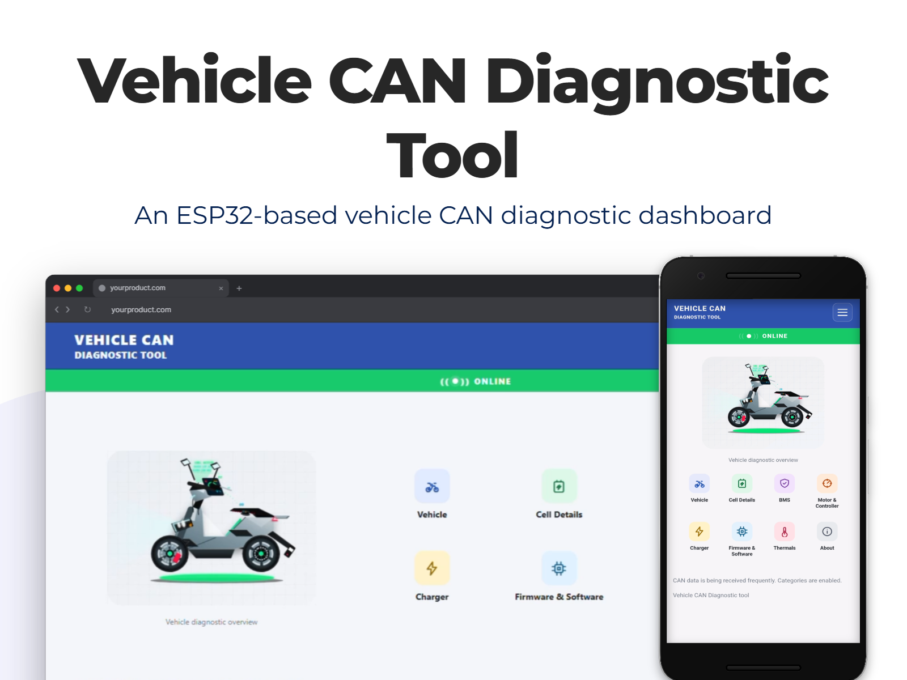
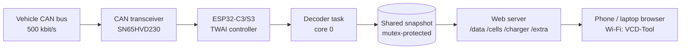

<div align="center">

# 🛵 Vehicle CAN Diagnostic Tool


**VCD Tool is an ESP32-based Ather vehicle CAN diagnostic dashboard. It presents available vehicle, battery, motor/controller, charger, firmware, and thermal telemetry from the connected vehicle. Displayed values depend on the signals decoded by the firmware.**



</div>

---

## 📖 Table of Contents

- [Overview](#-overview)
- [Features](#-features)
- [Quick Start](#-quick-start)
- [Documentation](#-documentation)
- [Repository Structure](#-repository-structure)
- [How It Works](#-how-it-works)
- [Safety & Disclaimer](#-safety--disclaimer)
- [Contributing](#-contributing)
- [Credits & Acknowledgements](#-credits--acknowledgements)
- [License](#-license)

---

## 🔍 Overview

The ESP32-TWAI connects to the vehicle's CAN bus through a CAN transceiver, decodes the frames it receives, and hosts a mobile-friendly dashboard over its own Wi-Fi hotspot. No internet, no app install, no phone pairing: join the hotspot, open a browser, and read your vehicle's data live.

> **Note:** Only signals that the firmware can decode are shown. Some values are marked **Estimated**, **Hypothesis** or **Rarely seen** on the dashboard because their meaning is not fully confirmed or they are broadcast only occasionally.

## ✨ Features

| Category | What you get |
|---|---|
| 🛵 **Vehicle** | Odometer, estimated range, drive mode, switch states (key, kill, brakes, horn, indicators, side stand), IMU and orientation |
| 🔋 **Cell Details** | Per-cell voltage, state of charge and state of health for all 14 cells, plus imbalance |
| 🛡️ **BMS** | Pack SoC/SoH/voltage/current, balancing, derated current limits, charge-algorithm limits, internal reference voltages |
| ⚙️ **Motor & Controller** | Motor current, throttle, RPM readings, motor/controller/MCU temperatures |
| ⚡ **Charger** | Input/output voltage, output current, calculated power, fan speeds, charge SoC limit, grid-support level |
| 💾 **Firmware & Software** | BMS / BCM / gateway / motor firmware versions, CAN health counters |
| 🌡️ **Thermals** | Cell probes, AFE die, FET, ambient, humidity, drive-unit temperatures |
| 📡 **Live status bar** | Green **ONLINE**, amber **intermittent** or red **OFFLINE** based on CAN frame freshness |

Other highlights:

- 📶 Built-in Wi-Fi access point, no router needed
- 📱 Responsive single-page dashboard, optimised for phones
- 🔒 Read-only design: the firmware never queues a frame for transmission
- 🧵 Dual-task firmware: CAN decoding runs on its own core so the web server never drops frames
- 🚫 No cloud, no telemetry, no tracking

## 🚀 Quick Start

1. **Get the hardware** (DIY build or pre-built) → [Hardware & Setup guide](docs/HARDWARE_AND_SETUP.md)
2. **Flash the firmware** → [Flashing steps](docs/HARDWARE_AND_SETUP.md#3-flashing-the-firmware)
3. **Connect to the vehicle** → [Connecting to the vehicle](docs/HARDWARE_AND_SETUP.md#4-connecting-to-the-vehicle)
4. **Open the dashboard**

| Setting | Value |
|---|---|
| Wi-Fi name (SSID) | `VCD-Tool` |
| Wi-Fi password | `123456789` |
| Dashboard address | `http://192.168.4.1` |


## 📚 Documentation

| Document | Description |
|---|---|
| [Hardware & Setup](docs/HARDWARE_AND_SETUP.md) | Parts list, wiring diagram, flashing, DIY vs pre-built |
| [Values Reference](docs/VALUES_REFERENCE.md) | Every label on the dashboard explained, grouped by screen |
| [Algorithms](docs/ALGORITHMS.md) | How raw CAN data becomes the values you see |
| [Pull Request Template](.github/PULL_REQUEST_TEMPLATE.md) | Checklist for contributions |
| [Issue Templates](.github/ISSUE_TEMPLATE/) | Bug report and feature/signal request forms |

## 🗂️ Repository Structure

```text
Vehicle_CAN_Diagnostic_tool/
├── README.md
├── firmware/
│   └── VCD_Tool/
│       └── VCD_Tool_C3.ino        # ESP32-C3 firmware (CAN + Wi-Fi + web dashboard)
│       └── VCD_Tool_S3.ino        # ESP32-S3 firmware (CAN + Wi-Fi + web dashboard)
├── docs/
│   ├── HARDWARE_AND_SETUP.md
│   ├── VALUES_REFERENCE.md
│   ├── ALGORITHMS.md
│   └── images/                   # screenshots used by the docs
└── .github/
    ├── PULL_REQUEST_TEMPLATE.md
    └── ISSUE_TEMPLATE/
        ├── bug_report.md
        └── feature_request.md
```

> Arduino IDE requires the sketch folder and `.ino` file to share the same name, hence `firmware/VCD_Tool/VCD_Tool.ino`.

## ⚙️ How It Works



The dashboard polls four lightweight JSON endpoints every 1.5 seconds. See [Algorithms](docs/ALGORITHMS.md) for details.

## 🛡️ Safety & Disclaimer

- This tool is built as a **read-only** reader. Even so, you are solely responsible for any wiring or connections you make to your vehicle.
- Always power the ESP32 down before wiring or re-wiring.
- This is a community, open-source project. **It is not affiliated with, endorsed by, or sponsored by Ather Energy Limited.** *Ather*, *Ather 450X*, *Ather Rizta* and related names are trademarks of **Ather Energy Limited**..
- Several signals are decoded from community reverse-engineering and are **not officially documented**. Treat values marked *Estimated* or *Hypothesis* with caution.
- The authors and contributors accept no liability for damage or loss arising from use of this project.

## 🤝 Contributing

Contributions are welcome: new signals, bug fixes, documentation, translations, screenshots.

1. Read the [Algorithms](docs/ALGORITHMS.md) and [Values Reference](docs/VALUES_REFERENCE.md) docs.
2. Open an [issue](https://github.com/Kukun7610/Vehicle_CAN_Diagnostic_tool/issues/new/choose) to discuss larger changes.
3. Fork, branch, commit, then open a pull request using the [PR template](.github/PULL_REQUEST_TEMPLATE.md).

## 🙏 Credits & Acknowledgements

This project would not exist without the original community work on Ather CAN diagnostics.

- **[SAM0-0](https://github.com/SAM0-0)** — author of **[ATHER-OBD-READER](https://github.com/SAM0-0/ATHER-OBD-READER)**. A number of the CAN signal definitions used in this firmware were taken from, or derived from.
- **[Kukun7610](https://github.com/Kukun7610)** — author and maintainer of the Vehicle CAN Diagnostic Tool; contributed the *Extra* battery/vehicle values to the original project.


## 📄 License

Released under the **Apache License 2.0**. See the `LICENSE` file for the full text.

If you reuse code, signal definitions or diagrams from this repository, please credit this project and the original [ATHER-OBD-READER](https://github.com/SAM0-0/ATHER-OBD-READER) by SAM0-0.


<div align="center">

⭐ If this tool helped you, consider starring the repository.

</div>
