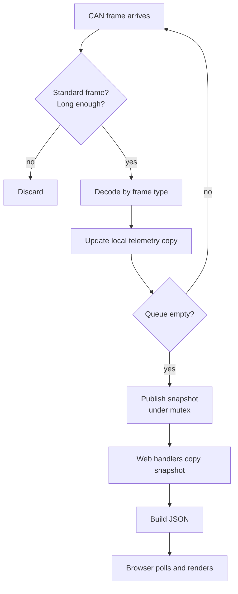

# 🧮 Algorithms

How VCD Tool turns raw CAN frames into the readings on the dashboard. This document describes the **methods** only. It intentionally lists no CAN identifiers.

**Contents**

1. [System architecture](#1-system-architecture)
2. [Bus configuration](#2-bus-configuration)
3. [Frame validation](#3-frame-validation)
4. [Decoding primitives](#4-decoding-primitives)
5. [Scaling to engineering units](#5-scaling-to-engineering-units)
6. [Multi-frame assembly](#6-multi-frame-assembly)
7. [Calculated and derived values](#7-calculated-and-derived-values)
8. [Freshness tracking](#8-freshness-tracking)
9. [Connection status state machine](#9-connection-status-state-machine)
10. [Thread-safe data hand-off](#10-thread-safe-data-hand-off)
11. [Float-free JSON output](#11-float-free-json-output)
12. [Health monitoring](#12-health-monitoring)
13. [Dashboard polling](#13-dashboard-polling)

---

## 1. System architecture



Two independent jobs run side by side:

| Job | Runs on | Responsibility |
|---|---|---|
| **CAN task** | Core 0, priority 2 | Receive, decode, publish snapshot |
| **Web loop** | Main loop | Serve the page and JSON, print health info |

Keeping them separate means a slow web request can never cause CAN frames to be dropped.

---

## 2. Bus configuration

| Parameter | Value | Why |
|---|---|---|
| Bit rate | **500 kbit/s** | Matches the vehicle bus |
| Acceptance filter | **Accept all** | The decoder picks what it needs |
| RX queue length | **128 frames** | Absorbs bursts |
| TX queue length | **0** | The firmware never queues a frame for transmission (read-only design) |

---

## 3. Frame validation

Every frame passes two checks before decoding:

```text
if frame is extended-ID or remote-request  → ignore
if payload length < minimum for this frame → ignore
```

The length check is per frame type, so a short or corrupted frame can never read bytes that were not sent.

---

## 4. Decoding primitives

### 4.1 Little-endian multi-byte values

Multi-byte numbers arrive least-significant byte first:

```text
value16 = byte0 + (byte1 << 8)
value32 = byte0 | (byte1 << 8) | (byte2 << 16) | (byte3 << 24)
```

Larger values (e.g. 40-bit BMS uptime) use the same pattern with a 64-bit variable.

### 4.2 Signed values

Where a value can be negative, the 16-bit result is reinterpreted as two's complement:

```text
signed16 = (int16)(byte0 + (byte1 << 8))
```

Used for temperatures, current, orientation and acceleration.

### 4.3 Single-bit flags

Switch and status flags are single bits within a byte:

```text
flag = (byte >> bitIndex) & 1
```

Used for brakes, high beam, horn, indicators, kill/start/storage switches, key, side stand, charger connected, balancing, seat/charger locks, fan state, smart/forced eco.

### 4.4 Bit-packed fields

Some signals do not align to byte boundaries. They are rebuilt by shifting and masking across neighbouring bytes:

```text
low  = (byteA >> n) | ((byteB & mask) << (8 - n))     # assemble 8 bits
```

#### Signed 9-bit values (motor current, throttle)

```text
raw9   = low8 + (signBit × 256) − (signBit × 512)
       = low8 − (signBit × 256)          # two's complement, 9 bits
```

| Signal | Resolution |
|---|---|
| Motor current | 0.1 A per count. Negative = regeneration |
| Throttle | 1 % per count |

#### Offset temperatures (motor, controller)

```text
temperature °C = packed8 − 40
```

The −40 offset lets an unsigned byte represent −40 … +215 °C.

### 4.5 Float reinterpretation

The charge-limit value is sent as an IEEE-754 32-bit float. The four bytes are copied into a `float` variable (byte-for-byte, no arithmetic) and then shown as a percentage.

### 4.6 Lookup tables

Drive mode is translated by a simple table:

| Raw | Label |
|---|---|
| 1 | SPORTS |
| 2 | DRIVE |
| 3 | ECO |
| 6 | WARP |
| 8 | S. ECO |
| other | UNKNOWN |

---

## 5. Scaling to engineering units

Raw integers are converted using fixed divisors. All arithmetic is integer-based.

| Quantity | Raw → Display |
|---|---|
| Pack SoC / SoH / Delta SoC | ÷ 100 → % |
| Pack voltage | ÷ 100 → V |
| Cell voltage, imbalance | ÷ 10 000 → V |
| Pack current | ÷ 100 → A |
| Derated / limit currents | ÷ 100 → A |
| Charger voltages & current | ÷ 1 000 → V / A |
| Reference voltages | ÷ 1 000 or ÷ 10 000 → V |
| Orientation (pitch/roll/heading) | ÷ 10 000 → ° |
| Odometer | ÷ 1 000 → km |
| Motor current | ÷ 10 → A |
| Traction-control RPM | × 5 ÷ 6 → RPM |
| Temperatures | Direct °C (some with −40 offset, see 4.4) |
| BMS uptime | ms → s → days / hours / minutes |

BMS uptime display:

```text
days    = seconds / 86400
hours   = (seconds % 86400) / 3600
minutes = (seconds % 3600) / 60
```

---

## 6. Multi-frame assembly

Some data is too large for one frame and is sent in pieces.

| Data | How it is assembled |
|---|---|
| **Cell voltages (14)** | Four cells per frame across four frames; each frame fills a fixed slice of the 14-slot array |
| **Per-cell SoH (14)** | 8 values + 6 values in two frames |
| **Per-cell SoC (14)** | 4 + 4 + 4 + 2 across four frames |
| **Cell temperatures (5)** | 4 + 1 across two frames |
| **VIN (17 chars)** | 8 + 8 + 1 characters from three frames, then terminated |
| **Battery ID (14 chars)** | 6 + 8 characters from two frames |
| **Firmware versions** | Three bytes → `major.minor.patch` |

Safety rules for text values:

```text
VIN        : stop at first byte outside printable ASCII (32–126)
Battery ID : keep only A–Z, a–z, 0–9, replace anything else with '?'
Gateway fw : accept only if at least one version byte is non-zero
```

---

## 7. Calculated and derived values

### 7.1 Charger power

```text
power (W) = outputVoltage (mV) × outputCurrent (mA) ÷ 1 000 000
```

A 64-bit multiply avoids overflow. The result is shown in **W**, or **kW** once it reaches 1 000 W.

### 7.2 Grid-support level

```text
if SoC > 80 %                         → "Discharge below 80% to calculate"
else if derated charge current > 60 A → "Full support, 6 kW"
else                                  → "Partial support, 3.3 kW"
```

The decision uses the BMS-reported derated charge current, so it reflects what the pack will currently accept.

### 7.3 Indicators summary

```text
indicators active = left OR right OR center
```

### 7.4 Parking-assist text

```text
if neither trigger ever seen → "Not triggered"
else                         → "A triggered Ns ago · B triggered Ns ago"
```

---

## 8. Freshness tracking

Rarely broadcast values (VIN, scooter ID, gateway firmware, parking-assist triggers, diagnostic-tool presence) would otherwise look permanently blank. Each stores the **time it was last seen**:

```text
lastSeen = millis()                    # when the value arrives
age      = millis() − lastSeen         # when displayed
```

Display rule:

```text
never received → "never seen"
age < 60 s     → "N s ago"
otherwise      → "N m ago"
```

Diagnostic-tool presence:

```text
age < 120 s → "Active N s ago"
otherwise   → "Not seen recently"
```

---

## 9. Connection status state machine

The ESP32 reports the **age of the newest CAN frame**; the browser decides the state.

```text
canAge = now − timeOfLastFrame
```

| Condition | State | UI |
|---|---|---|
| `canAge < 1 200 ms` | **Online** | 🟢 ONLINE, categories enabled |
| `1 200 ms ≤ canAge < 3 000 ms` | **Intermittent** | 🟡 CAN ACTIVITY INTERMITTENT, categories enabled |
| `canAge ≥ 3 000 ms`, no frame ever, or API unreachable | **Offline** | 🔴 OFFLINE, categories disabled |

If the vehicle goes offline while a category is open, the dashboard returns to the home screen so stale numbers are never shown as live.

---

## 10. Thread-safe data hand-off

```text
CAN task:                           Web handler:
  local = copy of snapshot            take mutex
  loop:                               copy = snapshot
    frame → decode into local         release mutex
    if queue empty:                   build JSON from copy
       take mutex
       snapshot = local
       release mutex
```

- The CAN task **decodes into a private copy**, so the mutex is held only for a quick memory copy.
- Snapshots are published **in batches** (when the queue drains), not per frame.
- Web handlers work on their own copy, so a response is always internally consistent.
- When idle, the CAN task sleeps 1 ms to let other tasks run.

---

## 11. Float-free JSON output

Decimal values are formatted with integer maths to avoid floating-point cost and rounding surprises:

```text
whole    = raw / scale
fraction = abs(raw % scale)
text     = whole "." fraction (zero-padded)
```

Other safeguards:

- Buffer sizes are fixed; every `snprintf` result is checked, and an overrun returns an error response instead of corrupt JSON.
- A negative fractional part is made positive; the sign stays with the whole part (motor current handles its sign separately so `-0.5 A` is not shown as `0.5 A`).
- Text from the bus is sanitised before being placed in JSON.

### HTTP endpoints

| Endpoint | Content |
|---|---|
| `/` | The dashboard page (stored in flash) |
| `/data` | Core vehicle and pack values, CAN age and online flag |
| `/cells` | 14 cell voltages and 14 cell SoH values |
| `/charger` | Charger, motor current/temperature, balancing, locks |
| `/extra` | Extended BMS, thermal, IMU, firmware and identity values |

---

## 12. Health monitoring

Every **5 seconds** the firmware prints to Serial:

```text
[DIAG] rx_missed  rx_overrun  arb_lost  max_backlog  heap
```

| Metric | Meaning | Healthy |
|---|---|---|
| `rx_missed` | Frames lost by the controller | 0 |
| `rx_overrun` | RX FIFO overflows | 0 |
| `arb_lost` | Arbitration losses | 0 |
| `max_backlog` | Largest batch decoded in one go (resets every 5 s) | Low, stable |
| `heap` | Free RAM | Stable, not shrinking |

---

## 13. Dashboard polling

```text
every 1.5 s:
    fetch /data, /cells, /charger, /extra   (in parallel, no caching)
    if any request fails        → Offline
    else compute state (section 9)
    if state ≠ Offline:
        map each JSON field to its on-screen label
        show "—" for anything not yet received
```

Values are written into the page by **label name**, so adding a new reading only needs a new label and one mapping entry.

---

## Adding a new signal

1. Add a field to the telemetry structure.
2. Decode it in the frame handler, following the [primitives](#4-decoding-primitives) and checking the minimum length.
3. Add it to the relevant JSON endpoint (watch buffer sizes).
4. Add a label in the matching dashboard category, with a tag if it is unconfirmed.
5. Document it in the [Values Reference](VALUES_REFERENCE.md).

---
