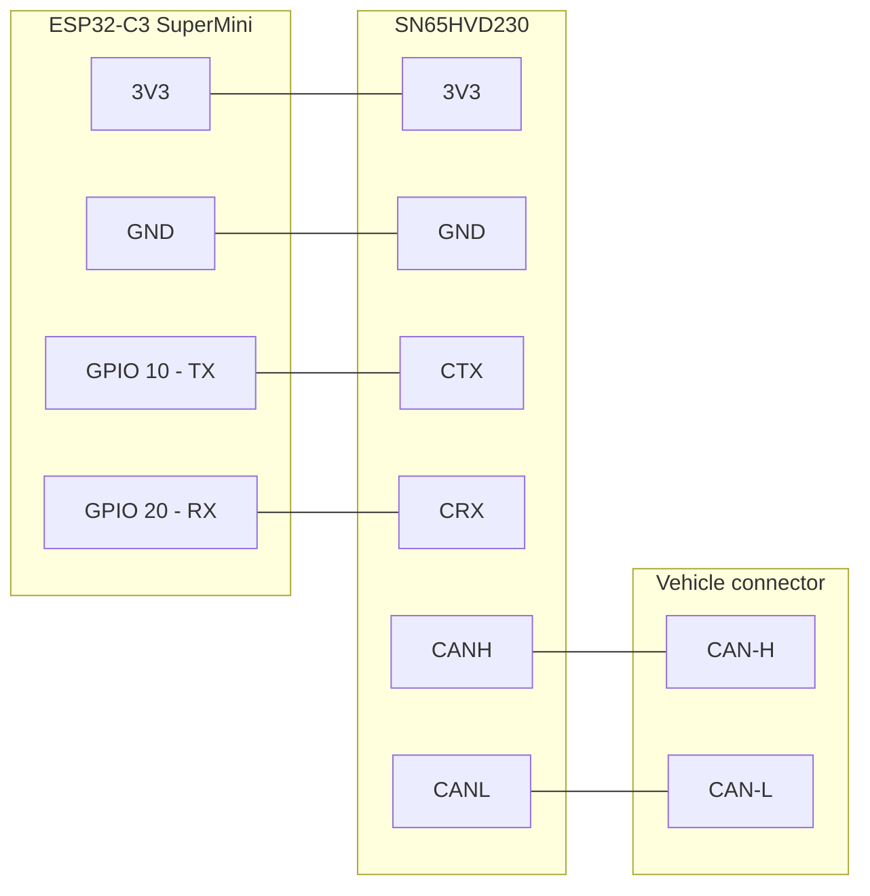
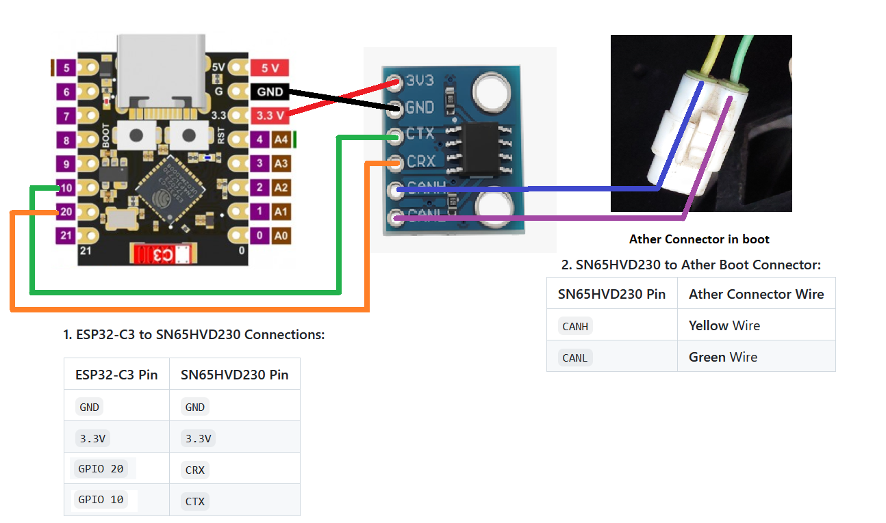
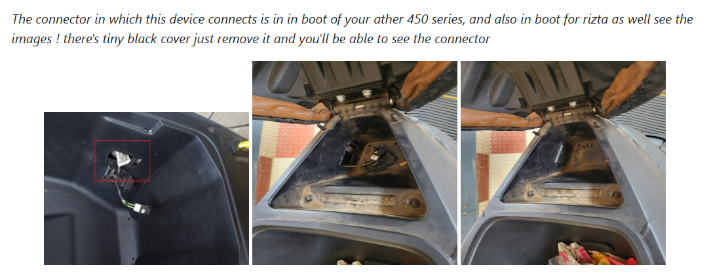

# 🔧 Hardware & Setup

There are two ways to get a working VCD Tool. Both use the **same hardware**: an ESP32-C3 board plus an SN65HVD230 CAN transceiver.

| | Option 1: DIY | Option 2: Pre-built |
|---|---|---|
| Effort | Wiring + flashing | Plug in and use |
| Soldering | None (jumper wires only) | None |
| Cost | Lowest | Slightly higher |
| Best for | Makers, learners | Anyone who wants it ready |

**Contents**

1. [Option 1: DIY build](#option-1-diy-build)
2. [Option 2: Get a pre-built device](#option-2-get-a-pre-built-device)
3. [Flashing the firmware](#3-flashing-the-firmware)
4. [Connecting to the vehicle](#4-connecting-to-the-vehicle)
5. [First use](#5-first-use)
6. [Troubleshooting](#6-troubleshooting)

---

## Option 1: DIY build

### 1.1 Parts list

| Qty | Part | Notes |
|---|---|---|
| 1 | **ESP32-C3 SuperMini** development board | USB-C, Wi-Fi + Bluetooth. This firmware is written for the C3 pin mapping below |
| 1 | **SN65HVD230** CAN bus transceiver module | 3.3 V device, matches ESP32 logic levels |
| 4 | Female-to-female jumper wires (≈10 cm) | ESP32-C3 ⇄ transceiver |
| 2 | Female-to-male jumper wires (≈10 cm) | Transceiver ⇄ vehicle connector |
| 1 | USB-C cable + power source | Phone, power bank or PC |

> ⚠️ **Use only one ESP32 board.** The sketch uses GPIO 10 (TX) and GPIO 20 (RX). Other ESP32 variants have different pins and require editing `CAN_TX` / `CAN_RX` in the sketch.

### 1.2 Pin connections

**ESP32-C3 SuperMini ⇄ SN65HVD230**

| ESP32-C3 pin | SN65HVD230 pin | Wire (suggested) | Purpose |
|---|---|---|---|
| `3V3` | `3V3` (VCC) | 🔴 Red | Power for transceiver |
| `GND` | `GND` | ⚫ Black | Common ground |
| `GPIO 10` | `CTX` (TXD / D) | 🟠 Orange | CAN transmit line |
| `GPIO 20` | `CRX` (RXD / R) | 🔵 Blue | CAN receive line |

**SN65HVD230 ⇄ Vehicle diagnostic connector**

| SN65HVD230 pin | Vehicle connector | Wire (suggested) |
|---|---|---|
| `CANH` | CAN-H pin | 🟡 Yellow |
| `CANL` | CAN-L pin | 🟢 Green |

> 📌 **TX/RX are crossed by design.** The ESP32's *TX* pin goes to the transceiver's *TX input* (`CTX`) and the ESP32's *RX* pin to the transceiver's *RX output* (`CRX`). Module silk-screens vary (`TXD`/`RXD`, `D`/`R`, `CTX`/`CRX`); match them by function.

### 1.3 Wiring diagram

```text
        ┌──────────────────────┐                     ┌────────────────────────┐
        │   ESP32-C3 SuperMini │                     │   SN65HVD230 module    │
        │                      │                     │                        │
        │   3V3  ●─────────────┼──────── red ────────┼─● 3V3                  │
        │   GND  ●─────────────┼──────── black ──────┼─● GND                  │
        │   GPIO10 (TX) ●──────┼──────── orange ─────┼─● CTX                  │
        │   GPIO20 (RX) ●──────┼──────── blue  ──────┼─● CRX                  │
        │                      │                     │                        │
        │   [USB-C] ← power    │                     │   CANH ●───────────┐   │
        └──────────────────────┘                     │   CANL ●────────┐  │   │
                                                     └─────────────────┼──┼───┘
                                                                       │  │
                                                 green (CAN-L) ────────┘  │
                                                  yellow (CAN-H) ─────────┘
                                                                       │  │
                                                             ┌─────────▼──▼────────┐
                                                             │  Vehicle diagnostic │
                                                             │  connector (boot)   │
                                                             └─────────────────────┘
```



 
 

### 1.4 Wiring checklist

- [ ] ESP32 is **unplugged** from USB/power while wiring
- [ ] `3V3` goes to the transceiver's `3V3` pin, **not 5 V**
- [ ] `GPIO 10` → `CTX`, `GPIO 20` → `CRX`
- [ ] CAN-H and CAN-L are not swapped (a swap just means no data, but double-check)
- [ ] No bare wire ends touching each other

Next: [flash the firmware](#3-flashing-the-firmware), then [connect to the vehicle](#4-connecting-to-the-vehicle).

---

## Option 2: Get a pre-built device

Don't want to wire anything? A fully assembled plug-and-play Ather OBD reader is sold by the author of the original **ATHER-OBD-READER** project.

| | |
|---|---|
| 🛒 **Buy a plug-and-play device** | **[a-obd.in](https://a-obd.in/)** |
| 📦 **Original project & hardware guide** | [github.com/SAM0-0/ATHER-OBD-READER](https://github.com/SAM0-0/ATHER-OBD-READER) |


### Using a pre-built device with the VCD Tool firmware

The pre-built unit uses the same hardware class (ESP32 + CAN transceiver) and plugs straight into the vehicle connector. It ships with the original author's firmware, which has its own Wi-Fi name and dashboard.

To run **VCD Tool** on it:

1. Confirm the board inside is an **ESP32-C3** and that the CAN transceiver is wired to **GPIO 10 (TX)** and **GPIO 20 (RX)**. If the pins differ, update `CAN_TX` / `CAN_RX` in the sketch.
2. Follow [Flashing the firmware](#3-flashing-the-firmware) below.
3. Plug the device into the vehicle as shown in [Connecting to the vehicle](#4-connecting-to-the-vehicle).

> ℹ️ Flashing replaces the original firmware. Keep a copy of the original firmware from the source project if you want to switch back.
>
> Pre-built devices are sold and supported by their maker, not by this project. For hardware questions about that device, contact the seller.

---

## 3. Flashing the firmware

### 3.1 Install the tools

1. Install the **[Arduino IDE 2.x](https://www.arduino.cc/en/software)**.
2. Open **File → Preferences** and add this URL to *Additional boards manager URLs*:

   ```text
   https://espressif.github.io/arduino-esp32/package_esp32_index.json
   ```
3. Open **Tools → Board → Boards Manager**, search for **esp32** (by Espressif Systems) and click **Install**.

No extra libraries are needed. `WiFi`, `WebServer` and the CAN driver (`driver/twai.h`) ship with the ESP32 core.

### 3.2 Open and configure the sketch

1. Download or clone this repository.
2. Open `firmware/VCD_Tool/VCD_Tool.ino` in the Arduino IDE.
3. Select the board settings:

   | Setting | Value |
   |---|---|
   | Board | **ESP32C3 Dev Module** |
   | USB CDC On Boot | **Enabled** (needed to see Serial output on the SuperMini) |
   | Upload Speed | 921600 (use 115200 if uploads fail) |
   | Port | The `COM X` / `/dev/tty` port of your board |

### 3.3 Upload

1. Connect the ESP32-C3 to your computer with a USB-C **data** cable (not charge-only).
2. Click **Upload** (→). Wait for *"Hard resetting via RTS pin…"*.
3. If upload fails to start, hold **BOOT**, tap **RESET**, release **BOOT**, then upload again.
4. Unplug and re-plug the board.
5. On your phone, look for a Wi-Fi network named **`VCD-Tool`**. If it appears, flashing worked ✅.

### 3.4 With ESP Flasher
1. Connect your ESP module to your PC/Laptop via USB.
2. Open the **ESP Flasher** application.
3. Select the correct COM/Serial port your ESP32 is connected to.
4. Select the proper `.bin` file provided in this folder for you selected hardware and click **Flash**.
5. Wait a minute for the process to complete, then disconnect and reconnect the ESP32 to restart it.

---

## 4. Connecting to the vehicle

> ⚠️ Switch the vehicle **off** and keep the ESP32 **unplugged** while you connect the wires.

1. Open the vehicle's boot / under-seat storage.
2. Locate the diagnostic connector behind the small black cover and remove the cover.
3. Plug in your device (pre-built) or connect your CAN-H / CAN-L wires (DIY) to the matching pins.
4. Power the ESP32-C3 from a USB power bank, a phone, or a PC.
5. Switch the vehicle on.



---

## 5. First use

1. On your phone or laptop, join Wi-Fi **`VCD-Tool`** (default password `123456789`).
2. Open a browser and go to **`http://192.168.4.1`**.
3. Wait a moment. The bar turns green and says **ONLINE** once CAN frames are arriving. The category icons are enabled only when data is live.

| Status bar | Meaning |
|---|---|
| 🟢 **ONLINE** | CAN frames arriving normally |
| 🟡 **CAN ACTIVITY INTERMITTENT** | Frames arriving, but with gaps |
| 🔴 **OFFLINE** | No recent CAN frames. Categories are disabled |

Your phone may warn that the network has no internet. That is expected; stay connected.

---

## 6. Troubleshooting

| Symptom | Likely cause | Fix |
|---|---|---|
| `VCD-Tool` Wi-Fi not visible | Flash failed or board not rebooted | Re-flash, then unplug and re-plug |
| Dashboard stays **OFFLINE** | No CAN data | Vehicle must be on; check CAN-H / CAN-L; try swapping them; check `GPIO 10/20` wiring |
| Intermittent / amber status | Loose jumper | Reseat wires; avoid long or loose leads |
| Page won't load | Phone uses mobile data | Turn on airplane mode, then re-enable only Wi-Fi; browse to `http://192.168.4.1` |
| `rx_missed` rising in Serial | Bus very busy | Report it via an issue with your log |
| Board gets warm | Normal for the C3 under load | Unplug between sessions; this tool is intended for diagnostic sessions rather than permanent installation |
| Upload fails | Wrong port / charge-only cable | Use a data cable; enter bootloader mode (BOOT + RESET) |

Still stuck? [Open an issue](https://github.com/Kukun7610/Vehicle_CAN_Diagnostic_tool/issues/new/choose) and include your board, Arduino core version and the Serial `[DIAG]` output.
