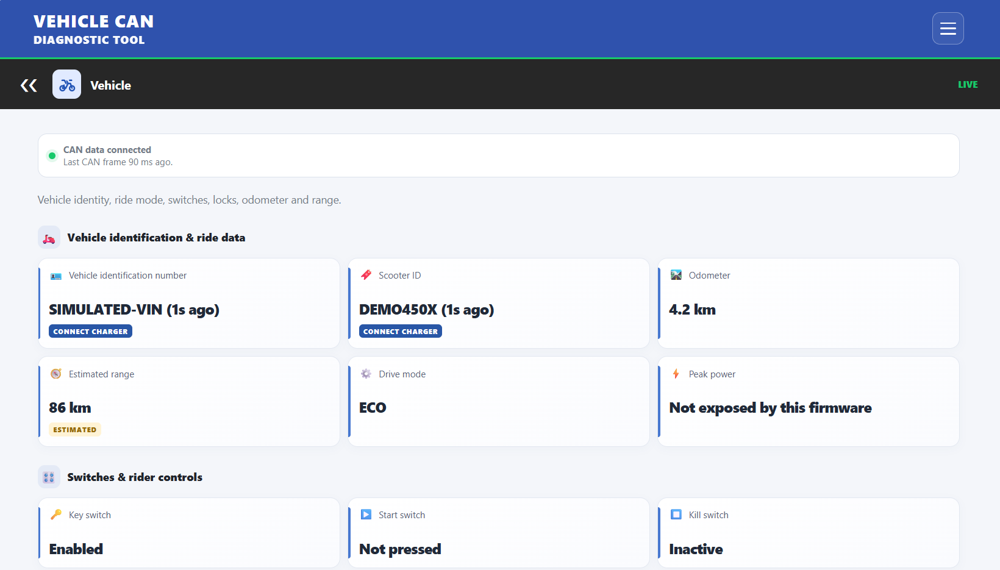
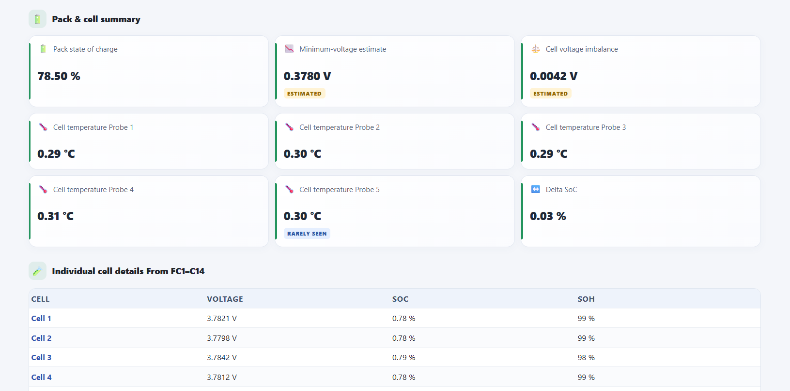
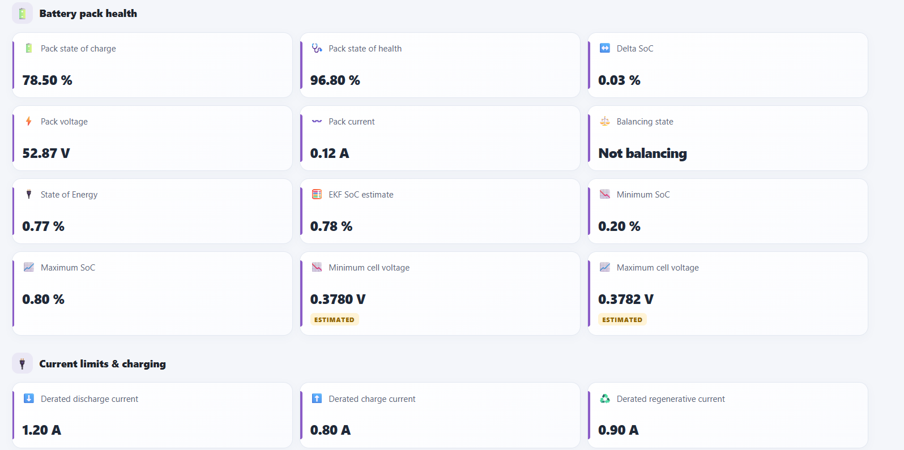
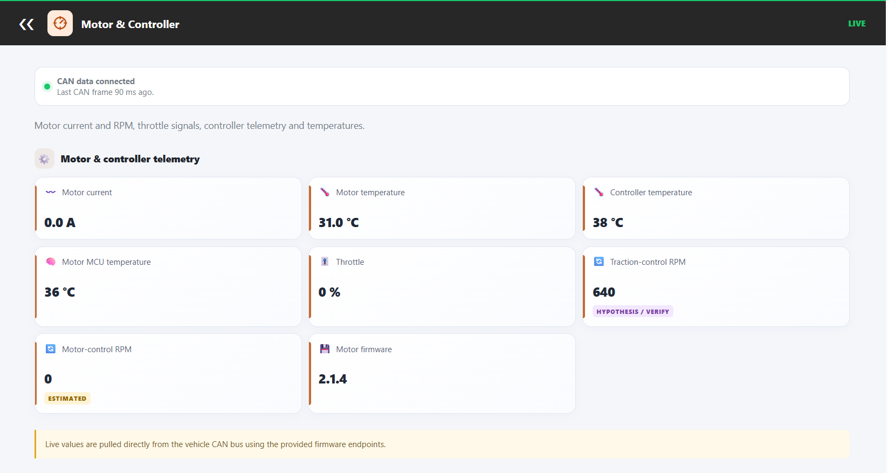
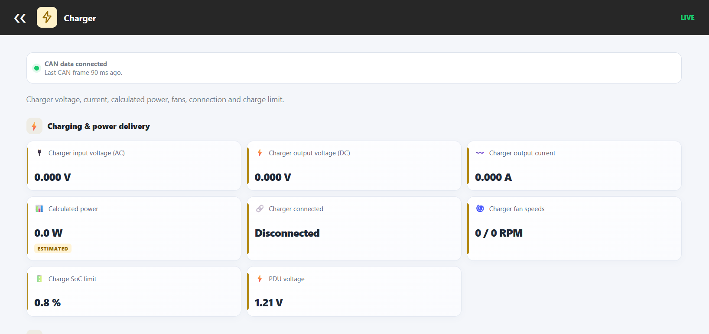
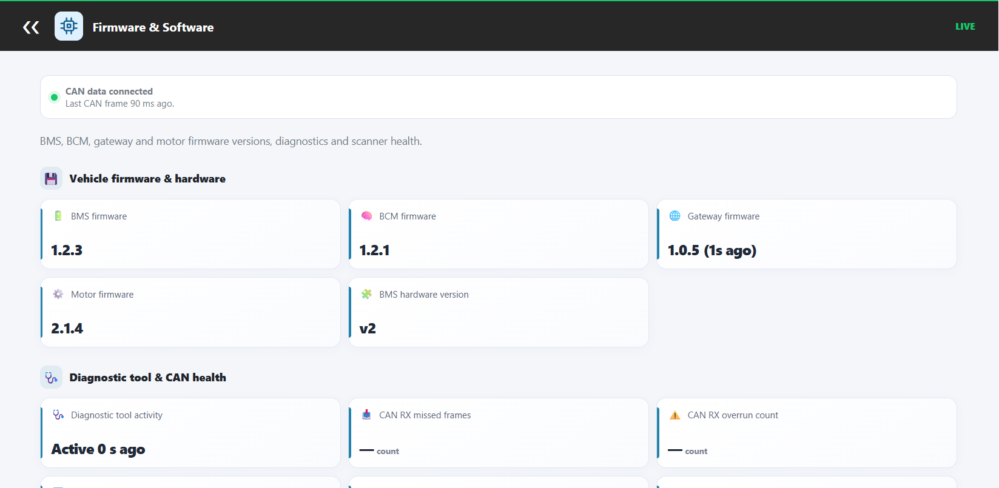
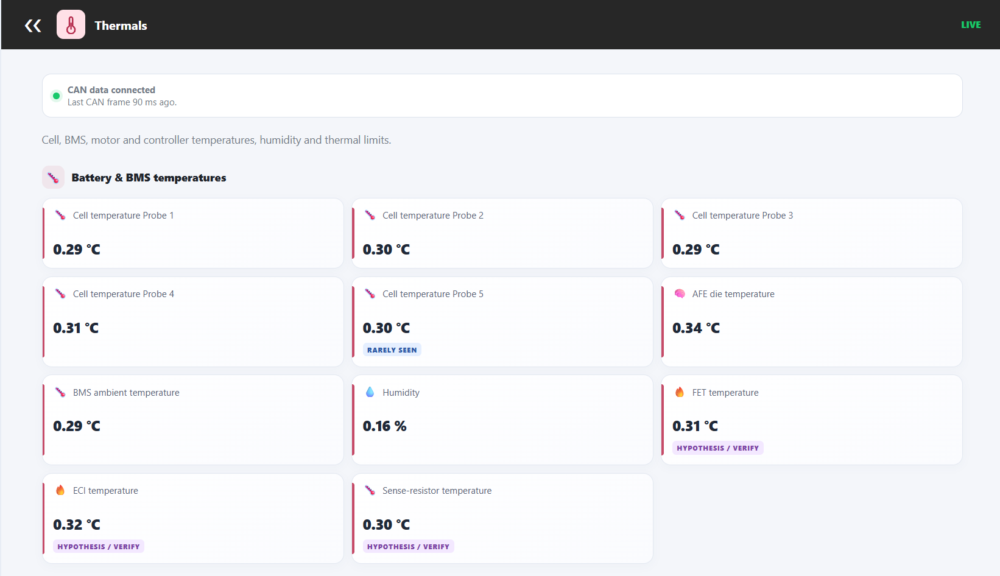

# 📘 Values Reference

A plain-language guide to every screen, label and abbreviation in the VCD Tool dashboard. It is written for riders and technicians, so it explains **what each value means**, not how it is decoded (see [Algorithms](ALGORITHMS.md) for that).

**Contents**

- [Abbreviations](#abbreviations)
- [Field tags](#field-tags)
- [Dashboard status](#dashboard-status)
- [1. Vehicle](#1--vehicle)
- [2. Cell Details](#2--cell-details)
- [3. BMS](#3--bms)
- [4. Motor & Controller](#4--motor--controller)
- [5. Charger](#5--charger)
- [6. Firmware & Software](#6--firmware--software)
- [7. Thermals](#7--thermals)
- [8. About](#8--about)

---

## Abbreviations

| Term | Full form | Meaning |
|---|---|---|
| **CAN** | Controller Area Network | The vehicle's internal communication bus |
| **TWAI** | Two-Wire Automotive Interface | Espressif's name for the CAN controller inside the ESP32 |
| **BMS** | Battery Management System | Electronics that monitor and protect the battery pack |
| **BCM** | Body Control Module | Controls lights, locks, switches and similar functions |
| **GTW** | Gateway | Module that bridges the vehicle's internal networks |
| **PDU** | Power Distribution Unit | Supplies the vehicle's low-voltage (≈12 V) systems |
| **MCU** | Microcontroller Unit | Small processor, here inside the motor controller |
| **AFE** | Analog Front End | The BMS chip that measures cell voltages and temperatures |
| **FET / MOSFET** | (Metal-Oxide) Field-Effect Transistor | Power switch that connects or disconnects the pack |
| **IMU** | Inertial Measurement Unit | Motion sensor (acceleration and orientation) |
| **SoC** | State of Charge | How full the battery is (%) |
| **SoH** | State of Health | Battery condition compared with new (%) |
| **SoE** | State of Energy | Remaining usable energy (%) |
| **EKF** | Extended Kalman Filter | A mathematical filter the BMS uses to estimate SoC |
| **VIN** | Vehicle Identification Number | Unique vehicle identifier |
| **VREF** | Voltage Reference | Stable internal voltage used by sensors |
| **NMC** | Nickel Manganese Cobalt | A common lithium-ion cell chemistry |
| **RPM** | Revolutions Per Minute | Rotation speed |
| **AP** | Access Point | The ESP32's own Wi-Fi hotspot |
| **A / V / W / kW / mV** | Amp / Volt / Watt / Kilowatt / Millivolt | Units |
| **°C** | Degrees Celsius | Temperature unit |

## Field tags

Some values carry a small tag so you know how far to trust them.

| Tag | Meaning |
|---|---|
| *(none)* | Decoded directly and considered reliable |
| `ESTIMATED` | Derived or calculated, or the BMS's own estimate |
| `HYPOTHESIS` | Best-known interpretation, not fully confirmed |
| `RARELY SEEN` | Broadcast only occasionally. Shows its age (e.g. "12s ago") or "never seen" |
| `CONNECT CHARGER` | Sensor input Update only when Charger connected |

## Dashboard status

| Indicator | Meaning |
|---|---|
| 🟢 **ONLINE** | CAN frames arriving frequently. All categories enabled |
| 🟡 **CAN ACTIVITY INTERMITTENT** | Frames arriving but with gaps. Categories stay enabled |
| 🔴 **OFFLINE** | No recent frames. All categories disabled until data resumes |
| **LIVE / DEGRADED / OFFLINE** (inside a category) | Same status, shown in the category header |
| **"—"** (a dash) | No value received yet |

---

## 1. 🛵 Vehicle

Identity, ride state, rider controls and motion.

### Vehicle identification & ride data

| Label | Unit | Meaning |
|---|---|---|
| Vehicle identification number | — | 17-character VIN. `RARELY SEEN`: only appears on some buses/sessions |
| Scooter ID | — | Short vehicle ID. `RARELY SEEN` |
| Odometer | km | Total distance travelled |
| Estimated range | km | Range predicted by the vehicle. `ESTIMATED` |
| Drive mode | — | Current riding mode: **Sports, Drive, Eco, Warp, S. Eco** or **Unknown** |
| Peak power | kW | Not exposed by this firmware |

### Switches & rider controls

| Label | Values | Meaning |
|---|---|---|
| Key switch | Enabled / Disabled | Ignition/key state |
| Start switch | Pressed / Not pressed | Start button |
| Kill switch | On / Off | Engine kill switch |
| Storage switch | On / Off | Storage (boot) switch |
| Parking assistant | Not triggered / "A/B triggered Ns ago" | One-shot parking-assist triggers |
| Nav joystick | Code *n* | Raw joystick code. Direction mapping unconfirmed (`HYPOTHESIS`) |
| Front brake / Rear brake | Pressed / Not pressed | Brake lever sensors |
| High beam | On / Off | Headlight beam |
| Horn | On / Off | Horn button |
| Left / Right / Center indicator | Active / Inactive | Individual indicator signals |
| Indicators / Blinkers | Active / Inactive | Active if any indicator is on |
| Side stand | Down / Up | Side-stand position |
| Seat lock | Locked / Unlocked | Seat latch |

### Vehicle IMU Details

| Label | Unit | Meaning |
|---|---|---|
| IMU acceleration X / Y / Z | m/s² (raw) | Acceleration on each axis |

### Vehicle Orientation

| Label | Unit | Meaning |
|---|---|---|
| Pitch | ° | Nose up/down tilt |
| Roll | ° | Left/right lean |
| Heading | ° | Direction the vehicle is facing |

---

## 2. 🔋 Cell Details

Per-cell data for the **14 cells** in the pack.

### Pack & cell summary

| Label | Unit | Meaning |
|---|---|---|
| Pack state of charge | % | Overall charge level |
| Minimum-voltage estimate | V | Lowest cell voltage estimate. `ESTIMATED` |
| Cell voltage imbalance | V | Gap between the highest and lowest cell voltage. Lower is better. `ESTIMATED` |
| Cell temperature Probe 1–4 | °C | Temperature probes on the cells |
| Cell temperature Probe 5 | °C | Fifth probe. `Unused in NMC` |

### Cell table

| Column | Meaning |
|---|---|
| Cell | Cell number 1–14 |
| Voltage | Cell voltage in volts (4 decimals) |
| SoC | Charge level of that cell |
| SoH | Health of that cell |

---

## 3. 🛡️ BMS

Battery pack level information straight from the BMS.

### Battery pack health

| Label | Unit | Meaning |
|---|---|---|
| Pack state of charge | % | Overall charge |
| Pack state of health | % | Overall battery health |
| Delta SoC | % | Charge spread reported by the BMS |
| Pack voltage | V | Total battery voltage |
| Pack current | A | Current into/out of the pack |
| Balancing state | Balancing / Not balancing | Whether the BMS is equalising cells |
| State of Energy | % | Usable energy remaining |
| EKF SoC estimate | % | SoC from the BMS's Kalman-filter estimator |
| Minimum / Maximum SoC | % | Lowest and highest SoC estimates |
| Minimum / Maximum cell voltage | V | Lowest and highest cell voltages |

### Current limits & charging

| Label | Unit | Meaning |
|---|---|---|
| Derated discharge current | A | Max discharge current allowed right now (reduced by heat, low charge, etc.) |
| Derated charge current | A | Max charge current allowed right now |
| Derated regenerative current | A | Max regenerative-braking current allowed |
| Temperature-based discharge limit | A | Discharge limit caused by temperature |

### BMS diagnostics & identity

| Label | Unit | Meaning |
|---|---|---|
| AFE die temperature | °C | Temperature of the BMS measurement chip |
| BMS uptime | d h m | Time since the BMS last started |
| BMS hardware version | — | Hardware revision (`v` + number) |
| Battery identification | — | Battery pack ID string |

### Charging Algorithm Limit

The BMS narrows the charge current in stages. These show each stage.

| Label | Unit | Meaning |
|---|---|---|
| Cell rule charge limit | A | Limit set by individual cell rules |
| Rate-limited charge current | A | Limit after rate limiting |
| Post-quantizer charge value | A | Final value after rounding to the charger's steps |

### Internal Reference Voltages

Health-check voltages inside the BMS. Useful to technicians; normally stable.

| Label | Unit | Meaning |
|---|---|---|
| Board temperature reference voltage | V | Reference used by the board temp sensor |
| VREF2 / VREF3 | V | Internal reference voltages |
| MOSFET power voltage | V | Supply for the power switches |
| AFE regulator voltage | V | Regulator output of the measurement chip |

---

## 4. ⚙️ Motor & Controller

| Label | Unit | Meaning |
|---|---|---|
| Motor current | A | Current in the motor. Negative = regeneration |
| Motor temperature | °C | Motor winding/body temperature |
| Controller temperature | °C | Motor-controller temperature |
| Motor MCU temperature | °C | Controller's processor temperature |
| Throttle | % | Throttle position/output |
| Traction-control RPM | RPM | RPM from the traction-control signal. `HYPOTHESIS` |
| Motor-control RPM | RPM | Likely true motor/wheel RPM, seen mainly while riding. `ESTIMATED` |
| Motor firmware | x.y.z | Motor-controller software version |

> The three temperatures are **independent readings** from different parts of the drive system.

---

## 5. ⚡ Charger

### Charging & power delivery

| Label | Unit | Meaning |
|---|---|---|
| Charger input voltage (AC) | V | Mains-side voltage |
| Charger output voltage (DC) | V | Voltage delivered to the battery |
| Charger output current | A | Current delivered to the battery |
| Calculated power | W / kW | Output voltage × output current. `ESTIMATED` |
| Charger connected | Connected / Disconnected | Charger plug state |
| Charger fan speeds | RPM | The two charger fans (fan 1 / fan 2) |
| Charge SoC limit | % | Charge target set for the current session |
| PDU voltage | V | Low-voltage system supply, around 12 V |

### 6 kW grid support

| Label | Meaning |
|---|---|
| Grid support capability | Whether the pack/charger supports 6 kW charging |
| Support level | **Full support, 6 kW** or **Partial support, 3.3 kW** |

> ℹ️ Determined from BMS data. If charge level is above 80%, the dashboard asks you to discharge below 80% so it can calculate.

---

## 6. 💾 Firmware & Software

### Vehicle firmware & hardware

| Label | Meaning |
|---|---|
| BMS firmware | Battery-management software version |
| BCM firmware | Body-control software version |
| Gateway firmware | Gateway software version (`RARELY SEEN`; shows `0.0.0` until the gateway broadcasts) |
| Motor firmware | Motor-controller software version |
| BMS hardware version | BMS board revision |

### Diagnostic tool & CAN health

| Label | Unit | Meaning |
|---|---|---|
| Diagnostic tool activity | — | Whether another diagnostic tool has recently been seen on the bus |
| CAN RX missed frames | count | Frames the ESP32 failed to receive. Should be 0 |
| CAN RX overrun count | count | Receive-buffer overflows. Should be 0 |
| Arbitration lost count | count | Bus arbitration losses. Should be 0 |
| Maximum queue backlog | count | Biggest burst of frames waiting to be decoded |
| Free heap | bytes | Free memory on the ESP32 |
| Wi-Fi AP status | — | Shows the configured hotspot name |

---

## 7. 🌡️ Thermals

### Battery & BMS temperatures

| Label | Unit | Meaning |
|---|---|---|
| Cell temperature Probe 1–5 | °C | Cell probes (Probe 5 `Unused in NMC`) |
| AFE die temperature | °C | BMS measurement chip temperature |
| BMS ambient temperature | °C | Air temperature around the BMS |
| Humidity | % | Humidity inside the battery enclosure |
| FET temperature | °C | Power-switch temperature |
| ECI temperature | °C | BMS internal sensor reading |
| Sense-resistor temperature | °C | Temperature of the current-sense resistor |

### Drive unit & thermal limits

| Label | Unit | Meaning |
|---|---|---|
| Motor temperature | °C | Motor temperature |
| Controller temperature | °C | Controller temperature |
| Motor MCU temperature | °C | Controller processor temperature |
| Temperature-related discharge restriction | A | Discharge limit imposed because of temperature |

---

## 8. ℹ️ About

Project information, contributors, repository link, suggestions and ways to contribute.

---

*Some meanings (marked `HYPOTHESIS` / `ESTIMATED`) come from community reverse-engineering and may be refined over time. If you can confirm or correct one, please open an issue or pull request.*
